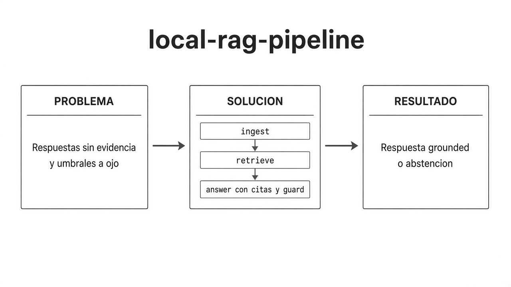
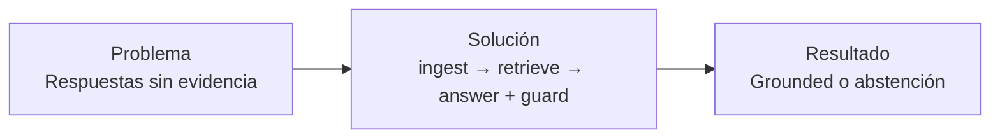

<div align="center">

# local-rag-pipeline

**RAG end-to-end en local** · Angel Salazar

`ingest → index → retrieve → answer + citas + guard`

<br/>


</div>

---

### `$ cat diagrama.md`



---

### `$ cat problema.md`

Construir un RAG no basta con “conectar un LLM a PDFs”.  
Hay que ingerir, fragmentar, recuperar y responder **con evidencia**, sabiendo callarse cuando no hay soporte.

Problemas que atacamos:

| Problema | Enfoque en este repo |
|---|---|
| Pipeline incompleto / demo-only | ingest → index → ask de punta a punta |
| Respuestas sin respaldo | citas por `doc_id` + faithfulness guard |
| Umbrales a ojo | sync desde tuner/abstention labs |
| Dependencia de cloud | 100% local (Ollama opcional) |

Se evalúa con `rag-eval-platform`.

---

### `$ whoami`

```text
stack: FastAPI + índice local + Ollama opcional
disciplina: abstenerse si no hay evidencia
syncs:
  - retrieval-tuner-local → TOP_K / MIN_SCORE
  - abstention-lab-local → MIN_SCORE / MIN_OVERLAP
```

---

### `$ ./pipeline.sh`

```bash
python -m venv .venv
.venv\Scripts\activate
pip install -e .
pytest
python -m local_rag ingest
python -m local_rag ask "¿Cuál es el límite comercial?"
python scripts/demo.py
python scripts/sync_from_tuner.py
python scripts/sync_from_abstention.py
python -m local_rag serve
```

Endpoints: `GET /health` · `POST /ingest` · `POST /ask`

---

### `$ cat contract.json`

```json
{
  "answer": "...",
  "citations": ["politica_a1"],
  "abstained": false,
  "guard_blocked": false,
  "guard_score": 0.91,
  "engine": "heuristic"
}
```

---

Hecho en Lima · Angel Salazar · CIP 404730
